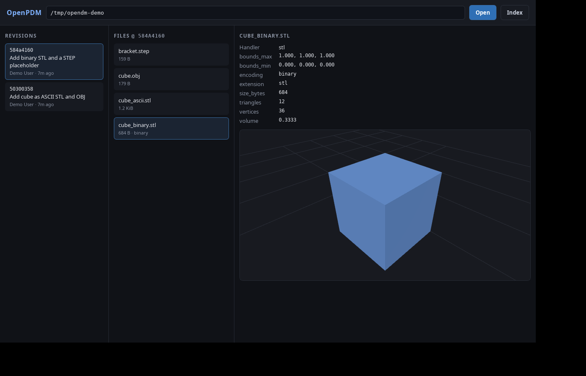

# OpenPDM

An open-source PDM (Product Data Management) app focused on CAD workflows,
built on **git + git-lfs** as the source of truth for file content.

This repository is a **first pass**: a working vertical slice from a real git
repository through to a live 3D preview.



## What works today

- **Core (Rust)** — open any local git repository (no remote required), or
  create one, walk revision history, list files at any revision, read blobs.
- **Content-addressed index (SQLite)** — indexes revisions and files keyed by
  git blob oid, so identical content is stored once per revision _and_ across
  repositories. Fully rebuildable from git; never committed.
- **Pluggable CAD handlers** — format-specific behaviour sits behind a
  `CadHandler` trait. Built-ins: STL (binary + ASCII), OBJ (mesh + metadata),
  FreeCAD `.FCStd` (document metadata + B-rep shapes) and STEP
  `.step`/`.stp` (header metadata + exact geometry), with a generic fallback for
  everything else. Native/proprietary CAD formats (SolidWorks, Inventor,
  Creo/NX, CATIA, kernel formats, …) are previewed by delegating to a
  user-configured external converter (see below); without one they still list
  and report metadata.
- **Desktop app (Tauri v2 + React + Tailwind + shadcn/ui + three.js)** — browse
  revisions and files, inspect extracted metadata, and preview meshes in a 3D
  viewport. FreeCAD B-rep shapes and STEP files are tessellated in the webview
  with `occt-import-js` (OpenCASCADE in WebAssembly).
- **Open revisions** — the Revisions panel leads with a **Current** entry: the
  uncommitted working tree. Its changed files can be staged into (and unstaged
  from) the revision via git's index; finalising the revision is not implemented
  yet.
- **Per-file history, checkout and delete** — the detail panel lists every
  committed version of the selected part (`Rev A`, `Rev B`, …) beside its
  metadata. Selecting a version previews it in the 3D viewer; **check out**
  restores that one file from the chosen revision into the working tree
  (staged, without moving HEAD), and **delete** rewrites history to drop that
  one version while keeping later versions. Both actions ask for confirmation
  first.
- **Project content allowlist** — only recognised CAD extensions (mesh formats,
  FreeCAD, STEP/IGES, common native CAD, DXF/DWG, …) appear in the Files panel
  and can be staged. Repository metadata, notes and generated files such as the
  `*.pdmdb` index are ignored. The list lives in
  `open_pdm_core::PROJECT_EXTENSIONS`.
- **Demo CLI (`openpdm`)** — the same core exposed from the terminal.

Not yet implemented (by design, see the plan): committing the open revision,
`git-lfs` transfer and locking, IGES tessellation, native in-process parsing
of proprietary formats, remote providers, thumbnails.

## Architecture

```
┌─ React + TypeScript + shadcn/ui + three.js ───────────┐
│  revisions · files · metadata · 3D viewer             │
└───────────────▲───────────────────────────────────────┘
      typed IPC │ (@tauri-apps/api invoke)
┌───────────────┴───────────────────────────────────────┐
│ Rust core (Tauri host)                                │
│  Project (git reads) · Index (SQLite) · Handlers      │
└───────────────────────────────────────────────────────┘
```

Design constraints baked in from the start:

- **Git is the source of truth**, the SQLite index is a rebuildable cache.
- **Content-addressing everywhere** (blob oid identity), so a future shared
  "vault" repo or cross-project BOM is a data-model change, not a rewrite.
- **Format-agnostic core**: nothing about SolidWorks/STEP etc. leaks into the
  core; it all lives in handlers (and external converters).

## Repository layout

```
crates/core/            Rust core: git, index, handlers, mesh
crates/cli/             `openpdm` demo CLI
apps/desktop/           Tauri v2 app (React + Tailwind + shadcn/ui + three.js)
apps/desktop/src-tauri/ Tauri host (thin IPC wrapper over core)
```

## Prerequisites (Development)

- Rust (stable) — https://rustup.rs
- Node.js + pnpm
- Linux desktop build deps (Debian/Ubuntu):

  ```sh
  sudo apt update
  sudo apt install -y \
    build-essential pkg-config \
    libwebkit2gtk-4.1-dev libgtk-3-dev libdbus-1-dev \
    libxdo-dev libssl-dev libayatana-appindicator3-dev librsvg2-dev
  ```

  `libdbus-1-dev` is required by Tauri's `tao` windowing layer; `pkg-config`
  is needed to locate the system libraries at build time.

- `git` (and `git-lfs` later, for LFS features)

## Build & run

### Core + CLI

```sh
cargo test --workspace          # run the test suite
cargo build --bin openpdm

# Try it on any repo:
target/debug/openpdm info        /path/to/repo
target/debug/openpdm revisions   /path/to/repo -n 20
target/debug/openpdm files       /path/to/repo
target/debug/openpdm meta        /path/to/repo path/to/part.stl
target/debug/openpdm mesh        /path/to/repo path/to/part.stl
target/debug/openpdm shapes      /path/to/repo path/to/document.FCStd
target/debug/openpdm index       /path/to/repo
target/debug/openpdm handlers
```

### Desktop app

```sh
cd apps/desktop
pnpm install
pnpm tauri dev        # dev, with hot reload
pnpm tauri build      # release bundle
```

Use **Open** to pick the folder of an existing project, or **New** to pick a
folder and initialise a fresh git repository in it. The path box shows (and can
still be edited to) the current project; it defaults to `/tmp/openpdm-demo`.

### Packaging a standalone binary

`tauri build` compiles the UI into the Rust binary (assets are embedded at
compile time via `generate_context!`), so the release executable needs no dev
server and no `node_modules`:

```sh
cd apps/desktop
pnpm tauri build
```

Outputs:

- **Standalone executable** — `src-tauri/target/release/open-pdm-app` (~15 MiB).
  Copy it anywhere and run it.
- **Installers** — `src-tauri/target/release/bundle/`:
  - `deb/OpenPDM_<ver>_amd64.deb` — `sudo dpkg -i <file>`, then run `open-pdm-app`
  - `rpm/OpenPDM-<ver>-1.x86_64.rpm`
  - `appimage/OpenPDM_<ver>_amd64.AppImage` — `chmod +x` and run (needs `libfuse2`,
    or use `--appimage-extract-and-run`)

The only runtime dependency is the OS webview (Linux: `libwebkit2gtk-4.1-0` +
`libgtk-3-0`; Windows: WebView2; macOS: system WKWebView). Bundles must be built
on their target OS — there is no Linux→Windows/macOS cross-compile.

## The handler seam

```rust
pub trait CadHandler: Send + Sync {
    fn name(&self) -> &'static str;
    fn extensions(&self) -> &'static [&'static str];
    fn metadata(&self, path: &str, bytes: &[u8]) -> Result<FileMetadata>;
    fn mesh(&self, path: &str, bytes: &[u8]) -> Result<Option<Mesh>>;
    // Optional: raw shapes for client-side tessellation (defaults to none).
    fn shape_payloads(&self, path: &str, bytes: &[u8]) -> Result<Vec<ShapePayload>>;
}
```

Adding a format means implementing this trait and registering it; the core and
UI do not change. Proprietary formats the core cannot parse itself are handled by
delegating to an external converter rather than in-process parsing (see below).

### FreeCAD documents (`.FCStd`)

A `.FCStd` file is a ZIP container: `Document.xml` is the manifest (document
metadata, objects and their properties), and each shape-bearing object stores its
exact geometry as an OpenCASCADE B-rep (`*.brp`). That is *not* a triangle mesh,
and the core deliberately has no geometry kernel, so the handler reports rich
metadata and advertises `tessellation = brep`, then exposes the raw `.brp`
payloads through `shape_payloads`. The desktop viewer feeds them to
`occt-import-js`, which tessellates in the webview; the wasm is loaded lazily, on
the first B-rep preview. Assemblies that only link to external parts carry no
embedded shapes and therefore have no 3D preview.

### STEP files (`.step` / `.stp`)

STEP (ISO 10303-21) is an exact B-rep exchange format, so the core cannot build a
triangle mesh itself either. The handler parses the exchange header for metadata
(description, originating system, schema, entity count, …) and advertises
`tessellation = step`; the viewer then hands the raw file to `occt-import-js`,
which reads it with `ReadStepFile` and tessellates it in the webview. Unlike
`.FCStd` there is nothing to unpack — the file *is* the payload — so no external
converter is needed for STEP.

### Native CAD formats via an external converter

Formats the core cannot parse itself — SolidWorks (`.sldprt`/`.sldasm`),
Inventor, Creo/NX, CATIA, kernel/exchange geometry (Parasolid, ACIS, IGES, …) —
are handled by a single converter-backed handler. It stays format-agnostic: you
configure an **external command** per format that produces an intermediate STL,
and the handler reuses the STL parser to build the mesh. There is deliberately no
bundled dependency on SolidWorks, eDrawings or a commercial SDK — you point
OpenPDM at whatever engine you own.

Configure backends in `<project>/.openpdm/converters.json` (machine-local and
gitignored, like the SQLite index), keyed by lower-case extension:

```json
{
  "converters": {
    "sldprt":  { "program": "edrawings-to-stl", "args": ["{in}", "{out}"] },
    "sldasm":  { "program": "edrawings-to-stl", "args": ["{in}", "{out}"] },
    "catpart": { "program": "hoops-exchange-to-stl", "args": ["{in}", "{out}"] }
  }
}
```

`{in}` and `{out}` are scratch files the program must read from and write to;
`{format}` expands to the target (`stl`). `program` may be an absolute path or a
bare executable name resolved from `PATH`. The program is run directly (argv, no
shell). Converted output is cached under `.openpdm/cache/stl/<converter>/` and
keyed by the input's git blob oid, so identical parts convert once across
revisions and switching converters invalidates the cache.

A ready-to-build reference backend that uses the **free eDrawings Viewer API**
(no SOLIDWORKS license) lives in
[`examples/converters/edrawings-to-stl`](examples/converters/edrawings-to-stl).
It includes build/publish scripts that produce a self-contained `win-x64` exe
(no .NET runtime required on the target machine).

Without a backend the file still lists and reports metadata; the viewer shows a
hint explaining how to enable the preview. The CLI exposes the same path:
`openpdm meta <repo> part.sldprt` and `openpdm mesh <repo> part.sldprt`.

## License

MIT OR Apache-2.0
